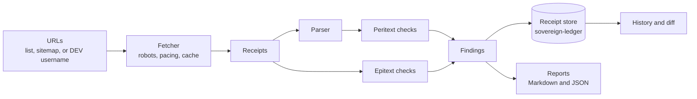

# Cernis: Design Note and Plan of Attack

**Status:** Draft 2.1 (2026-10-28). Draft 2.1 adds key normalization (Unicode NFC, URL targets). Draft 2 answered the seven issues raised in Session 1: what NOT_DETERMINABLE must record, `based_on` in reports, a Snapshot for history, stable finding keys, rate limiting and fetch errors, a URL comparison rule, and where fixtures belong.
**Owner:** Ken W. Alger
**Repository:** `kenwalger/cernis` (to be created)
**Package:** `cernis` on PyPI (to be reserved with v0.0.1)

*Primum cerne, deinde suade.* First discern, then advise.

---

## 1. What Cernis is

Cernis is a content discoverability auditor for published articles. Given the URL of a published article, it fetches the page and the things around it, evaluates them with deterministic checks, and produces findings backed by evidence.

It answers questions like:

- Does this DEV cross-post point its canonical URL at my WordPress original?
- Does each page carry the metadata that search engines, social cards, and feed readers read?
- Which crawlers does each site's robots.txt allow to read this page?
- Do the links in the article still resolve?
- What changed since the last audit, and who changed it?

Cernis is a separate project from Afterword, with its own repository and package. Afterword will become its first consumer, but Cernis takes URLs, not Afterword article IDs, so it works on any public article.

### The name

From Latin *cernere*: to separate, distinguish, discern, decide. It is the root of "discern" and shares an ancestor with "criterion" and "certain." *Cernis* is a real Latin form, "you discern," which suits a tool that lays out evidence and leaves the judgment to the author.

**Pronunciation:** KER-nis, the classical Latin, with a hard C. The README says so in its first lines. (Ecclesiastical Latin would give CHER-nis; English speakers will guess SER-nis. Both are forgivable, neither is the name.)

Using the Latin pronunciation makes room for Latin elsewhere in the brand: the motto above, the status vocabulary in section 3, and section epigraphs in the docs.

---

## 2. Principles

1. **Distinguish what was observed from what is recommended from what is unknown.** This is the defining characteristic of the tool. Section 3 makes it formal.
2. **No scores.** No "discoverability score," no grades, no percentages that pretend to summarize a page. A list of findings with evidence is the output.
3. **No predicted outcomes.** A recommendation may say what to change and why. It may never say what will happen as a result ("this will improve rankings," "this will increase AI citations").
4. **A defect is a violation of a published standard or of the author's own stated intent, never of a style convention.** Two canonical tags on one page is a defect (the HTML standard expects one). A DEV copy whose canonical does not point at the original the author declared is a defect (it contradicts the author's intent). A 74-character title is not a defect; it is a fact, and Cernis reports it as one.
5. **Absence is evidence.** "We looked for X in these places and found no X" is a finding in its own right. Every check records what it searched, not only what it found. This comes directly from the Discoverability Stack's "absence as a provenance category."
6. **Findings are receipts.** Every finding records the URL fetched, the time, the response hash, the evidence, and the check version, so anyone can see exactly what Cernis saw.
7. **Deterministic first.** The MVP has no model in the loop. Any judgment-based check, later, is a new experiment with stated claims and falsifiers, in the Afterword style.
8. **Polite by default.** Audit your own content only, identify yourself, respect robots.txt, pace requests, cache.

---

## 3. The finding model

Every finding has two independent fields: **status** (how sure we are) and **actor** (whose job it is).

### Status

| Status | Meaning | Rules |
| --- | --- | --- |
| `OBSERVED` | A condition verified directly from fetched content | Must carry evidence: where Cernis looked and what it found, or exactly what it searched for and did not find. Has a `defect` flag, true only under principle 4. |
| `RECOMMENDATION` | A suggested change | Must reference at least one `OBSERVED` finding by ID. Phrased as an action. Must not predict an outcome. |
| `NOT_DETERMINABLE` | A question Cernis was asked, or would naturally be asked, but cannot answer from what it can see | Must state the question and a reason code. When Cernis attempted something (a fetch, a search of the page), it must carry evidence of the attempt. When no attempt was possible (`REQUIRES_EXTERNAL_DATA`, `PLATFORM_OPAQUE`), it must instead state, in `would_require`, what data would answer the question. |

Fields that belong to another status are rejected: a `rationale` on an `OBSERVED` finding is an error, not an extra.

In reports, the third status is shown as **Not determinable (*non liquet*)**. *Non liquet*, "it is not clear," was the verdict a Roman judge could give when a case could not be decided on the evidence. It is the most honest sentence a tool can say, and Cernis will say it often.

Reason codes for `NOT_DETERMINABLE`:

| Code | Example |
| --- | --- |
| `REQUIRES_EXTERNAL_DATA` | "Is this page cited by AI assistants?" cannot be answered from the page. |
| `PLATFORM_OPAQUE` | How DEV ranks posts in its own feed. |
| `FETCH_FAILED` | Timeout, connection error, TLS error, too many redirects, 5xx. The receipt's `error_kind` says which. |
| `ACCESS_DENIED` | 401 or 403. A 403 is not a broken link; it is an unanswered question. |
| `RATE_LIMITED` | 429, after retrying with backoff (honoring `Retry-After`) and still being refused. Temporary by nature, so a later run may answer it. |
| `DISALLOWED_BY_ROBOTS` | Cernis's own user agent is disallowed, so it did not look. |
| `REQUIRES_RENDERING` | The content only exists after JavaScript runs. The MVP has no headless browser. |
| `AMBIGUOUS` | The evidence supports more than one reading (for example, two different canonical URLs). |

### Actor

| Actor | Meaning | Examples |
| --- | --- | --- |
| `AUTHOR` | The author can change it | DEV front matter (canonical URL, description, cover image); anything on WordPress |
| `PLATFORM` | Only the platform can change it | dev.to's robots.txt, DEV's page template |
| `UNKNOWN` | Cannot tell who controls it | A tag that could come from a theme or a plugin |

The same check can produce different actors on different sites: robots.txt is `PLATFORM` on dev.to and `AUTHOR` on kenwalger.com.

### The no-promise rule, enforced

A test in the test suite scans every recommendation template for outcome language ("will improve," "will increase," "boost," "rank higher," "more traffic," "more citations," and so on) and fails if it finds any. Principle 3 is a build failure, not a style guideline.

### Finding fields (sketch)

```text
Finding
  id                 unique within a run
  key                stable across runs: hash of (check_id, normalized subject_url, target)
  check_id           e.g. "peri.canonical.present"
  check_version      e.g. "1"
  target             what specifically was checked, when a check covers several things
                     (e.g. "og:image", or a link URL); empty otherwise
  status             OBSERVED | RECOMMENDATION | NOT_DETERMINABLE
  defect             bool (OBSERVED only)
  actor              AUTHOR | PLATFORM | UNKNOWN
  subject_url        the article URL the finding is about
  evidence           list of Evidence (receipt id, location, and either the value found
                     or what was searched for and not found; an empty string is a value)
  summary            one sentence, plain English
  rationale          RECOMMENDATION only: why, citing the standard or the stated intent
  based_on           RECOMMENDATION only: OBSERVED finding ids, checked at run assembly
  reason_code        NOT_DETERMINABLE only
  question           NOT_DETERMINABLE only: what could not be answered
  would_require      NOT_DETERMINABLE only, when no attempt was possible: the data
                     that would answer the question
```

Before hashing, every string in the key is normalized to Unicode NFC. A `target` that is a URL (a link, an image) goes through the same URL normalization as `subject_url`; any other `target` is an identifier Cernis itself supplies (a property name such as `og:image`, a crawler name), drawn from a fixed vocabulary, so it needs no normalization. Key computation must be final before Phase 5 stores any runs, because changing it changes every key.

The `key` leaves out `check_version` on purpose. When a check's version changes, the same key appearing with a different version is how history recognizes a `CHECKER` change instead of a new problem.

### Receipt fields (sketch)

A receipt records the raw facts of one fetch, and nothing parsed.

```text
Receipt
  id
  requested_url
  final_url          after redirects (None if no response)
  redirect_chain
  status_code        None if no response
  error_kind         NONE | TIMEOUT | CONNECTION | TLS | TOO_MANY_REDIRECTS
  fetched_at         UTC
  body_sha256        of the raw response body (None if no response)
  headers            a fixed subset (content-type, etag, last-modified, retry-after,
                     x-robots-tag), stored as a sorted tuple of (name, value) pairs
  cernis_version
  user_agent
```

### Snapshot fields (sketch)

A snapshot is what the parser derived from one receipt. History compares snapshots, not raw bodies, because a raw body changes whenever a platform rotates an asset hash or a CSRF token.

```text
Snapshot
  receipt_id
  extractor_id       e.g. "dev.article" or "wordpress.entry"
  extractor_version
  content_sha256     normalized text of the article body only (None if not found)
  head_sha256        normalized, sorted metadata from <head>: canonical, meta, og:*,
                     JSON-LD, lang, title
  frame_sha256       the rest of the page, normalized (navigation, footer, template)
```

Finding the article body needs a site-aware extractor (DEV's article container, WordPress's entry content). If the extractor finds no body, `content_sha256` is None, and any change involving that snapshot is `UNCLASSIFIED`.

### URL comparison

Checks that compare URLs (`peri.og.url_matches_canonical`, `epi.pair.canonical`) use one shared function with three outcomes, so that cosmetic differences never become false defects (claim C-3 depends on this):

| Outcome | When | Result |
| --- | --- | --- |
| `IDENTICAL` | The strings match exactly | No defect |
| `EQUIVALENT` | They match after normalizing: scheme and host lowercased, default port removed, fragment removed, trailing slash on the path ignored, percent-encoding normalized; or one redirects to the other (recorded with the redirect receipt) | No defect; the difference is reported as a fact |
| `DIFFERENT` | Anything else, including a different scheme (http versus https), a different host, a different path, or a different query string | Defect, where the check says so |

Query strings are compared exactly. Cernis does not guess which parameters are "only tracking."

---

## 4. What Cernis checks: peritext and epitext

Gérard Genette split a book's *paratext*, everything that surrounds a text and shapes how it reaches readers, into two parts. **Peritext** is on or in the work itself: title, preface, notes. **Epitext** is outside it: interviews, reviews, correspondence. Cernis uses the same split for its two families of checks.

### Peritext: on the page

Checks against the fetched HTML of the article itself.

"Reports" is what every run records. "Defect when" is the only condition that sets `defect`; "never" means the check reports facts only.

| ID | Reports | Defect when |
| --- | --- | --- |
| `peri.canonical.present` | Whether a `<link rel="canonical">` exists | Never (the pair check decides whether a missing canonical contradicts intent) |
| `peri.canonical.single` | How many canonicals, and their values | More than one with values that are not `IDENTICAL` or `EQUIVALENT` |
| `peri.canonical.absolute` | Whether the canonical is an absolute URL | Relative or malformed |
| `peri.meta.description` | Presence, and length in characters | Never (absence and length are facts) |
| `peri.og.core` | Presence of `og:title`, `og:description`, `og:image`, `og:url`, one finding per property (the property is the `target`) | Never |
| `peri.og.url_matches_canonical` | The URL comparison outcome | `DIFFERENT` |
| `peri.lang` | The `<html lang>` value, or its absence | Never |
| `peri.jsonld.parses` | Each JSON-LD block's `@type`, one finding per block | A block fails to parse as JSON |
| `peri.title` | The `<title>` and its length | Never |

### Epitext: around the page

Checks against things outside the article's HTML.

| ID | Reports | Defect when |
| --- | --- | --- |
| `epi.pair.canonical` | **The flagship check.** Given a declared original and copy: the URL comparison outcome for the copy's canonical against the original, and for the original's canonical against itself | Either comparison is `DIFFERENT`, or the copy has no canonical at all |
| `epi.canonical.resolves` | The canonical URL's status and redirect chain | 404 or 410 (401 and 403 are `ACCESS_DENIED`; 429 is `RATE_LIMITED`) |
| `epi.og.image.resolves` | The `og:image` URL's status and content type | 404 or 410, or a 200 that is not an image content type |
| `epi.robots.access` | What the site's robots.txt says about this URL for general crawlers and for each named AI crawler (one finding per crawler; the crawler is the `target`) | Never; whether to allow AI crawlers is the author's or platform's choice |
| `epi.sitemap.listed` | Whether the URL appears in the site's sitemap (WordPress) | Absent from a sitemap that exists and lists other posts |
| `epi.links.resolve` | Each body link's status, paced (the link is the `target`) | 404 or 410 only |

### Explicitly out of scope for the MVP

- Any score, grade, or summary number
- Any outcome prediction
- Any model or LLM in the loop
- Keyword density, readability scores, "AI citation readiness," heading-count advice
- Title-length and description-length judgments (lengths are reported as facts)
- Headless rendering
- Any platform beyond DEV and WordPress (the engine is platform-neutral; the fixtures and pair check target these two first)

---

## 5. History and change classification

Each audit run is appended to a tamper-evident ledger. Comparing two runs of the same URL produces **change events** at two levels.

**Finding changes**, matched by finding `key`: a key that appears, disappears, or changes status, defect, or evidence value between runs.

**Page changes**, from the two runs' snapshots, classified by who caused them:

| Class | How Cernis decides |
| --- | --- |
| `CHECKER` | The Cernis version, an extractor version, or a check version differs between the runs. Checked first. |
| `AUTHOR_CONTENT` | `content_sha256` changed |
| `AUTHOR_METADATA` | `head_sha256` changed in fields the author controls on that site (DEV front matter fields; anything on WordPress) |
| `PLATFORM_RENDERING` | `content_sha256` is unchanged, and `frame_sha256` or platform-controlled head fields changed |
| `UNCLASSIFIED` | More than one of the above at once, a missing `content_sha256`, or evidence that does not separate them |

A finding change is attributed to the page change of the same run pair, so a report can say "this defect appeared after a `PLATFORM_RENDERING` change," which tells the author it is not their doing.

`UNCLASSIFIED` is the change-tracking equivalent of *non liquet*, and it is a legitimate answer. When the checker changed between runs, Cernis says so first, because otherwise a new check looks like a new problem with the page.

---

## 6. Architecture



### Package layout (sketch)

```text
src/cernis/
  __init__.py
  cli.py              argparse entry point
  model.py            Finding, Evidence, Receipt, enums
  fetch/              httpx client, robots.txt, pacing, cache
  parse/              HTML extraction
  checks/
    peritext/
    epitext/
    registry.py       check ids and versions
  store/
    base.py           ReceiptStore protocol
    ledger.py         sovereign-ledger implementation
    memory.py         in-memory implementation for tests
  history/            diff and change classification
  report/             markdown.py, json.py
tests/
  fixtures/           synthetic HTML pages, robots.txt files, sitemaps
```

### Stack

- **Python 3.12+**, managed with **uv**
- Afterword's standards: strict mypy, ruff, pydoclint, Sphinx-style docstrings, type hints throughout
- **httpx** for fetching
- **selectolax** for HTML parsing (lxml as the fallback if selectolax misses something)
- **urllib.robotparser** from the standard library
- **argparse** for the CLI
- **sovereign-ledger** for the receipt store, behind the `ReceiptStore` protocol
- Apache-2.0

### Sovereign Systems SDK

Cernis is a deliberate real-world test of the SDK, its first consumer outside the SDK's own repositories.

- **sovereign-ledger** stores every receipt and finding as an append-only, hash-chained entry. "Findings are receipts" stops being a metaphor: the audit history is tamper-evident, and truncation is detectable through the expected tip hash.
- **sovereign-sieve** is *evaluated*, not assumed, for the extraction step. If it fits HTML and metadata extraction, use it; if not, use selectolax and record why.
- **The protocol boundary matters.** Cernis defines its own small `ReceiptStore` interface and adapts the ledger to it. A ledger limitation must never block the audit engine, and two experimental projects must not share each other's failure modes.
- **Friction is a deliverable.** Every rough edge in the SDK goes into `docs/SDK-FRICTION.md` in the Cernis repository, then into issues on the SDK. That log is good SDK work and good content.

### Polite fetching

- Only URLs the author lists, or that come from the author's own sitemap or DEV username
- User agent: `Cernis/<version> (+https://github.com/kenwalger/cernis)`
- Cernis checks robots.txt for its own user agent before fetching, and records a `DISALLOWED_BY_ROBOTS` finding instead of fetching when disallowed
- At most one request per second per host, with a configurable delay
- Conditional requests (ETag, Last-Modified) and a local cache in a git-ignored directory
- No credentials in the MVP. DEV article pages and the public DEV articles listing need no API key.

### Data and privacy

Cernis reads public pages of the author's own articles. It never touches comments, so none of Afterword's comment-data rules come into play. The cache holds public HTML of the author's own pages; it is git-ignored anyway, so fixtures stay synthetic and the repository stays clean.

---

## 7. The CLI (sketch)

```text
cernis audit <url> [<url> ...] [--format md|json]
cernis audit --from-sitemap <sitemap-url>
cernis audit --from-dev-user <username>
cernis pair --original <url> --copy <url>
cernis pairs --map <file>            a list of original/copy pairs
cernis history <url>
cernis diff <url> [--from <run-id>] [--to <run-id>]
cernis checks                        list every check with its id, version, and family
cernis --version
```

### Example report (Markdown)

```markdown
# Cernis audit: A Word List Tied the Model

Copy:     https://dev.to/kenwalger/a-word-list-tied-the-model-xxxx
Original: https://kenwalger.com/blog/a-word-list-tied-the-model/
Run:      20261117T180000Z · Cernis 0.1.0

## Observed

- DEFECT · AUTHOR · epi.pair.canonical
  The DEV copy's canonical points at the DEV copy itself, not the original.
  Evidence: <link rel="canonical" href="https://dev.to/kenwalger/..."> (receipt r-002)

- AUTHOR · peri.meta.description
  Meta description present, 151 characters. (receipt r-002)

- PLATFORM · epi.robots.access
  dev.to robots.txt allows general crawlers for this path; GPTBot: allowed;
  ClaudeBot: allowed. (receipt r-004)

## Recommendations

- Set `canonical_url` in the DEV front matter to the original URL.
  Why: you declared kenwalger.com as the original; the copy's canonical contradicts it.
  Based on: epi.pair.canonical (the DEV copy's canonical points at itself)

## Not determinable (non liquet)

- Whether AI assistants cite this article.
  Reason: REQUIRES_EXTERNAL_DATA. The page cannot answer this.

- Whether https://example.org/paper resolves.
  Reason: ACCESS_DENIED (403). Not reported as a broken link.
```

`based_on` stores finding ids. Reports render each one as the check id plus that finding's summary, never a bare id.

---

## 8. Claims and falsifiers

Written before building, in the Afterword style. Numbers marked *proposed* are fixed before the first full audit of the real articles, and recorded with the date.

| ID | Claim | Falsified if |
| --- | --- | --- |
| C-1 | Deterministic checks find at least one author-actionable defect on a meaningful share of my published articles | Fewer than 10% (*proposed*) of audited articles have any `AUTHOR` defect |
| C-2 | Repeat audits of unchanged pages are stable | Any change event appears across 5 (*proposed*) back-to-back runs on pages known not to have changed, other than `CHECKER` |
| C-3 | Observed defects are real | On my own review of every defect from the first full audit, fewer than 95% (*proposed*) are genuine |
| C-4 | The three statuses are used honestly | Any `RECOMMENDATION` lacks a `based_on` link, or any recommendation text fails the no-promise test (a hard rule; zero tolerance) |
| C-5 | sovereign-ledger works as a store for a real consumer without changes to its public API | Cernis needs a ledger API change to function (any friction short of that is logged, not a falsification) |

C-3 is the important one. A tool that claims to report only observed defects has to show that its observed defects are actually defects.

---

## 9. Relationship to Afterword

- **No Afterword code changes during the Afterword test period.** Afterword's application version is frozen at 0.2.0 by the preregistration. Integration (Afterword calling Cernis, or showing Cernis findings next to a post's comments) waits until after Afterword's reveal.
- **Cernis can be built during the test period**, because it is a separate repository and never touches Afterword's frozen code, data, or ledger.
- **Fixing your posts is fine.** If Cernis finds a bad canonical on a test-period post, fix it. Afterword measures comments, not post metadata.
- **Shared look.** Same palette and typeface family (section 11), so the two read as siblings.
- **A shared idea.** Afterword's design rule is "the model classifies, the policy decides." Cernis's is "the checks observe, the author decides." Both keep a hard line between evidence and judgment.

---

## 10. Plan of attack

Each phase is one or more numbered Claude Code sessions, with the usual CLAUDE.md, friction log, and `commit-message.txt` (no attribution lines; you commit).

| Phase | What | Done when |
| --- | --- | --- |
| 0 | Reserve the name: v0.0.1 on PyPI (prompt in section 12). Logo and BRAND.md. | `pip index versions cernis` shows 0.0.1 |
| 1 | Scaffold: repo, CLAUDE.md, tooling, `model.py` with the finding and receipt types, status rules as validators, the no-promise test, `cernis checks` | Done in Session 1. Session 1b aligns the model with draft 2. |
| 1.5 | CI on Python 3.12 to 3.14, and Trusted Publishing to PyPI | CI green on a pull request; `docs/RELEASING.md` written |
| 2 | Fetcher: httpx client, robots.txt for its own user agent, pacing, retry with backoff for 429, cache, receipts with `error_kind` | Receipts produced against a local test server, including 403, 404, 429, redirects, and timeouts |
| 3 | Parser and snapshots, the URL comparison function, peritext checks, run assembly (including the `based_on` check), Markdown/JSON reports, synthetic HTML fixtures; evaluate sovereign-sieve | `cernis audit <url>` produces a report from fixtures and from one real article |
| 4 | Epitext checks, including the flagship pair check; URL sources (sitemap, DEV username) | `cernis pairs --map` runs over all cross-posted articles |
| 5 | Ledger store, history, finding keys across runs, diff, change classification | C-2 stability runs pass |
| 6 | Fix the *proposed* numbers, run the first full audit, review every defect, evaluate C-1 to C-5 | An evaluation note, and material for an article |

A natural first article: *Non Liquet: Building an Auditor That Admits What It Can't See.*

---

## 11. Brand

### Relationship to Afterword

Cernis uses Afterword's palette and typeface family so the two read as siblings, but its own concept, so neither copies the other's logo.

| Role | Name | Hex |
| --- | --- | --- |
| Observed, on light backgrounds | Ink | `#111111` |
| Recommendation and not determinable, on light backgrounds | Afterword Blue | `#477AA3` |
| Observed, on dark backgrounds | Paper | `#F2F2F2` |
| Recommendation and not determinable, on dark backgrounds | Afterword Blue, light | `#6B9BC3` |

Typeface: **IBM Plex Sans**, as in Afterword.

### Concept: three treatments, one shape

*Cernere* means to separate. The mark is a single shape divided into three parts, one for each status:

- **Solid** (Ink): observed. Evidence you can hold.
- **Outlined** (blue): recommendation. A shape drawn but not filled; a suggestion, not a fact.
- **Dashed** (blue): not determinable. An outline Cernis could only partly trace.

As in Afterword, where meaning is carried by posture first and color second, in Cernis **meaning is carried by line treatment first and color second.** The mark still reads in monochrome, in print, and for viewers who do not distinguish the two colors.

The same three treatments mark findings in the reports: a solid, outlined, or dashed badge beside each finding. The logo explains the tool.

### The wordmark

"Cernis" in IBM Plex Sans SemiBold, Ink (Paper on dark), set by hand in a design tool, not generated. The mark sits to its left. Unlike Afterword, the wordmark is not split into two styles; the mark carries the concept.

### Logo prompt (mark only)

Image generators garble letters and drift on precise geometry, so generate the **mark** only and set the wordmark yourself. Two directions:

**Direction A: the divided circle**

> A minimalist geometric logo mark, flat vector, centered on a pure white background. A single circle divided into three equal wedges, like a pie cut into thirds, with small, even gaps between the wedges. The top-left wedge is solid, filled in near-black (#111111). The top-right wedge is drawn as an outline only, a clean medium-weight stroke in muted steel blue (#477AA3), with an empty white interior. The bottom wedge is drawn as a dashed outline of the same weight in the same steel blue (#477AA3), with an empty white interior and evenly spaced dashes. All three wedges are the same size, with crisp edges and consistent stroke width. No gradients, no shadows, no texture, no text, no letters, no numbers. Precise, calm, scholarly, like a mark on a scientific instrument or an archival stamp. Must remain legible as a small app icon.

**Direction B: the letter C, in three arcs**

> A minimalist geometric logo mark, flat vector, centered on a pure white background. A bold, open, geometric capital letter C formed by three arc segments of equal length, separated by small, even gaps. The first arc is solid, filled in near-black (#111111). The second arc is drawn as an outline only, a clean medium-weight stroke in muted steel blue (#477AA3), with an empty white interior. The third arc is drawn as a dashed outline of the same weight in the same steel blue (#477AA3), with evenly spaced dashes. Thick, even arc width, crisp edges, generous negative space. No gradients, no shadows, no texture, no other letters, no numbers, no words. Precise, calm, scholarly, in the spirit of a mid-century typographic emblem. Must remain legible as a small app icon.

Direction B echoes Afterword's "Aw" mark, a letter carrying the concept. Direction A is simpler and survives small sizes better.

Notes:

- **A hand-drawn SVG may beat the generator.** Both directions are simple geometry. Generate a few for the feel, then have the final mark drawn as an SVG (by hand, or in a Claude Code session) so the wedges are exactly equal and the strokes exactly even.
- **Check the favicon by eye**, as BRAND.md requires for Afterword's mark. Dashes may blur at 16 pixels. If they do, the 16- and 32-pixel versions can swap the dashed part for a lighter tint or a dotted line, and BRAND.md records the exception.
- **Dark variant:** Paper (`#F2F2F2`) for the solid part, `#6B9BC3` for the other two.

Cernis gets its own BRAND.md, modeled on Afterword's: concept, colors, the line-treatment rule, variants, usage rules, and the name in prose (**Cernis**, capital C only).

### Latin, on brand

Candidates, to be checked by someone with better Latin than either of us before they go on anything permanent:

| Latin | English | Use |
| --- | --- | --- |
| *Primum cerne, deinde suade.* | First discern, then advise. | Motto: observation comes before recommendation |
| *Non liquet.* | It is not clear. | The not-determinable status, in reports |
| *Quod vidi, scripsi.* | What I saw, I wrote. | README epigraph; a play on *quod scripsi, scripsi* |
| *Absentia quoque testis.* | Absence, too, is a witness. | Epigraph for the "absence is evidence" principle |

Use them sparingly: a motto, a status name, an epigraph or two. Reports stay in plain English, with *non liquet* as the one Latin term readers will actually meet.

---

## 12. Claude Code prompt: reserve the name with v0.0.1

PyPI discourages empty placeholder packages, so this is a tiny but real package: a working CLI that reports its version and says what the project is. It does not touch Afterword and can run before the seal.

Start a fresh Claude Code session in an **empty folder** named `cernis`, and paste:

```text
Create the minimum real Python package needed to publish `cernis` v0.0.1 to
PyPI and reserve the name. This is a new, standalone project; do not touch
any other repository. Do not commit; write commit-message.txt instead, with
no AI attribution lines of any kind.

Project facts:
- Name: cernis (pronounced KER-nis, classical Latin, from cernere, "to
  discern")
- What it will be: a content discoverability auditor for published
  articles. It fetches a published article and the things around it, runs
  deterministic checks, and reports findings that distinguish what was
  observed, what is recommended, and what cannot be determined. No scores,
  no predicted outcomes.
- Author: Ken W. Alger
- License: Apache-2.0
- Repository: https://github.com/kenwalger/cernis
- Python 3.12+, managed with uv

Build:
1. Check https://pypi.org/pypi/cernis/json first. If it does not return
   404, stop and tell me; the name is no longer free.
2. git init. A src layout: src/cernis/__init__.py (with __version__ =
   "0.0.1"), src/cernis/__main__.py, src/cernis/cli.py.
3. pyproject.toml with uv's build backend (or hatchling if uv's is not
   available), name, version, description, readme, requires-python >=3.12,
   license Apache-2.0, authors, project URLs (Homepage, Repository,
   Issues), classifiers including "Development Status :: 1 - Planning",
   and a console script `cernis = cernis.cli:main`. No runtime
   dependencies.
4. The CLI uses argparse. `cernis --version` prints "cernis 0.0.1".
   `cernis` with no arguments prints one paragraph saying Cernis is in
   early development, what it will do, and the repository URL, then exits
   0.
5. README.md: the name, the pronunciation in the first lines, the motto
   "Primum cerne, deinde suade. (First discern, then advise.)", a short
   description, a "Status: early development, nothing usable yet" line,
   and the license.
6. LICENSE (full Apache-2.0 text, copyright 2026 Ken W. Alger), a Python
   .gitignore (include dist/ and .env), and a minimal CHANGELOG.md with a
   0.0.1 entry.
7. Dev tooling, matching my other projects: ruff, mypy --strict, pytest,
   pydoclint, Sphinx-style docstrings, type hints throughout. Two or three
   tests for the CLI (version output, the no-argument message, exit code).
8. Run the full check list (ruff, mypy, pytest), then `uv build`, and
   confirm dist/ contains one sdist and one wheel. Inspect the wheel's
   METADATA and confirm the name, version, license, and URLs.
9. Do NOT publish. Print the publishing steps for me (below) and stop.

Never read or print any .env file or token.
```

### Publishing it yourself (PowerShell)

1. **Create a PyPI API token.** Log in to pypi.org, then Account settings, API tokens, Add API token. For a first upload the scope must be **"Entire account"**, because a project-scoped token can only be created once the project exists.
2. **Optional rehearsal on TestPyPI** (needs a separate account and token at test.pypi.org):

   ```powershell
   $env:UV_PUBLISH_TOKEN = "<your TestPyPI token>"
   uv publish --publish-url https://test.pypi.org/legacy/
   ```

3. **Publish for real:**

   ```powershell
   $env:UV_PUBLISH_TOKEN = "<your PyPI token>"
   uv publish
   Remove-Item Env:UV_PUBLISH_TOKEN
   ```

4. **Check it:** open https://pypi.org/project/cernis/ and confirm 0.0.1 is there.
5. **Tighten up afterward:** delete the account-wide token, and for future releases either create a token scoped to `cernis` only or set up Trusted Publishing from a GitHub Actions workflow, which needs no stored token at all.
6. Create the `kenwalger/cernis` repository on GitHub, review `git status`, commit with `commit-message.txt`, and push.

---

## 13. Open questions

1. **sovereign-sieve's fit** for HTML and metadata extraction. Decided in Phase 3.
2. **Which named AI crawlers** `epi.robots.access` reports on, and how that list is versioned as new crawlers appear. Probably a data file with its own version, so a list update shows up as a `CHECKER` change.
3. **Where the original/copy pairing comes from.** A hand-written map file for the MVP; later, perhaps derived from each DEV post's declared canonical and the WordPress sitemap.
4. **Whether to read DEV's public API** for the list of articles, or only the HTML pages. The public listing needs no key, but it is another dependency on DEV's behavior.
5. **The *proposed* numbers in section 8**, fixed and dated before the first full audit.
6. **A Latin check** on the motto and epigraphs before they go on anything permanent.