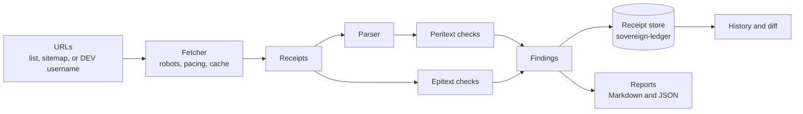

# Cernis: Design Note and Plan of Attack

**Status:** Draft 2.11 (2026-11-04). Draft 2.11 records Session 6b: C-5 falsified and the gaps fixed in the SDK (sovereign-sdk-ledger 2.0.0), claim C-5b stated with its falsifiers, and the receipt ledger (section 5): what each run appends, the field mapping, idempotency keys, the tip anchor, and what a failed write does. Draft 2.10 records Session 6a: a time budget for a whole fetch (finding D33), and the finding that sovereign-sdk-ledger 1.3.0 has no public way to read entries back, which stopped the store (section 8, C-5, pending the Owner's decision). Draft 2.9 records Session 5e: the fixes from the tier comparison (`docs/experiments/2026-11-tier-comparison.md`): more refused address ranges and IPv6 translation forms, a bounded DNS lookup, robots.txt read to 500 KiB, and fragments never requested. Draft 2.8 records Session 5d: the results of claims C-1 and C-3 from the first full audit, C-1b proposed, principles 9 and 10, and Phases 2 to 4 marked done. Draft 2.7 recorded Session 5c: the claim numbers fixed in section 8, `wordpress.entry` version 2 (share widgets left out of the article body), a whole-origin `[[site]]` prefix as one sitemap section, site-level findings (`epi.og.image.shared`) and the report's Site section, and the run summary (counts of `AUTHOR` defects per article, for C-1). Draft 2.6 recorded Session 5b: `peri.robots.directives`, `epi.robots.access` with a versioned AI crawler list, `epi.sitemap.listed`, `epi.links.resolve` with its limits, the `LIMIT_REACHED` reason code (ADR-001 amendment 2), the sitemap and DEV user URL sources, `copies` in the pair map, and `cernis pairs --from-dev-user`. Draft 2.5 recorded Session 5a: the `owned` site type, the pair commands and the pair check, canonical and og:image resolution, one fetch per distinct URL per run, and the Open Graph citation for `peri.og.url_matches_canonical`. Draft 2.4 added dot-segment removal to URL equivalence, and declared site types for extractor selection (Session 4a). Draft 2.3 added the `ADDRESS_REFUSED` error kind and reason code from Session 3b, and corrects the stack list. Draft 2.2 recorded the Session 3 decisions: receipts on failure (ADR-004), one receipt per attempt, truncated bodies (ADR-003), a Cernis-owned RFC 9309 matcher, 429 on robots.txt, and refusing non-public addresses. Draft 2.1 added key normalization (Unicode NFC, URL targets). Draft 2 answered the seven issues raised in Session 1: what NOT_DETERMINABLE must record, `based_on` in reports, a Snapshot for history, stable finding keys, rate limiting and fetch errors, a URL comparison rule, and where fixtures belong.
**Owner:** Ken W. Alger
**Repository:** `kenwalger/cernis` (to be created)
**Package:** `cernis` on PyPI (to be reserved with v0.0.1)

*Primum cerne, deinde suade.* First discern, then advise.

---

## 1. What Cernis is

Cernis is a content discoverability auditor for published articles. Given the URL of a published article, it fetches the page and the things around it, evaluates them with deterministic checks, and produces findings backed by evidence.

It answers questions like:

- Does this DEV cross-post point its canonical URL at my WordPress original?
- Does each page carry the metadata that search engines, social cards, and feed readers read?
- Which crawlers does each site's robots.txt allow to read this page?
- Do the links in the article still resolve?
- What changed since the last audit, and who changed it?

Cernis is a separate project from Afterword, with its own repository and package. Afterword will become its first consumer, but Cernis takes URLs, not Afterword article IDs, so it works on any public article.

### The name

From Latin *cernere*: to separate, distinguish, discern, decide. It is the root of "discern" and shares an ancestor with "criterion" and "certain." *Cernis* is a real Latin form, "you discern," which suits a tool that lays out evidence and leaves the judgment to the author.

**Pronunciation:** KER-nis, the classical Latin, with a hard C. The README says so in its first lines. (Ecclesiastical Latin would give CHER-nis; English speakers will guess SER-nis. Both are forgivable, neither is the name.)

Using the Latin pronunciation makes room for Latin elsewhere in the brand: the motto above, the status vocabulary in section 3, and section epigraphs in the docs.

---

## 2. Principles

1. **Distinguish what was observed from what is recommended from what is unknown.** This is the defining characteristic of the tool. Section 3 makes it formal.
2. **No scores.** No "discoverability score," no grades, no percentages that pretend to summarize a page. A list of findings with evidence is the output. The run summary (Session 5c) gives plain counts only: each article's number of `AUTHOR` defects, and how many of the run's articles have at least one ("3 of 25"), the measure claim C-1 is judged on. Defects are never weighted, and no count is turned into a percentage or a rating.
3. **No predicted outcomes.** A recommendation may say what to change and why. It may never say what will happen as a result ("this will improve rankings," "this will increase AI citations").
4. **A defect is a violation of a published standard or of the author's own stated intent, never of a style convention.** Two canonical tags on one page is a defect (the HTML standard expects one). A DEV copy whose canonical does not point at the original the author declared is a defect (it contradicts the author's intent). A 74-character title is not a defect; it is a fact, and Cernis reports it as one.
5. **Absence is evidence.** "We looked for X in these places and found no X" is a finding in its own right. Every check records what it searched, not only what it found. This comes directly from the Discoverability Stack's "absence as a provenance category."
6. **Findings are receipts.** Every finding records the URL fetched, the time, the response hash, the evidence, and the check version, so anyone can see exactly what Cernis saw.
7. **Deterministic first.** The MVP has no model in the loop. Any judgment-based check, later, is a new experiment with stated claims and falsifiers, in the Afterword style.
8. **Polite by default.** Audit only what principle 9 allows, identify yourself, respect robots.txt, pace requests, cache.
9. **Audit content you are authorized to audit.** That means your own content, or a client's with their permission. Auditing someone else's public pages is limited to a small, polite sample (robots.txt respected, normal pacing, no limits raised), for example to test a claim such as C-1b in section 8.
10. **Facts are not defects after the fact.** A claim's result never reclassifies findings to rescue the claim. A fact stays a fact and a defect stays a defect, whatever a run's result turns out to be; a change to what counts as a defect is a new check version, made for its own reasons and recorded before the run it applies to.

---

## 3. The finding model

Every finding has two independent fields: **status** (how sure we are) and **actor** (whose job it is).

### Status

| Status | Meaning | Rules |
| --- | --- | --- |
| `OBSERVED` | A condition verified directly from fetched content | Must carry evidence: where Cernis looked and what it found, or exactly what it searched for and did not find. Has a `defect` flag, true only under principle 4. |
| `RECOMMENDATION` | A suggested change | Must reference at least one `OBSERVED` finding by ID. Phrased as an action. Must not predict an outcome. |
| `NOT_DETERMINABLE` | A question Cernis was asked, or would naturally be asked, but cannot answer from what it can see | Must state the question and a reason code. When Cernis attempted something (a fetch, a search of the page), it must carry evidence of the attempt. When no attempt was possible (`REQUIRES_EXTERNAL_DATA`, `PLATFORM_OPAQUE`), it must instead state, in `would_require`, what data would answer the question. |

Fields that belong to another status are rejected: a `rationale` on an `OBSERVED` finding is an error, not an extra.

In reports, the third status is shown as **Not determinable (*non liquet*)**. *Non liquet*, "it is not clear," was the verdict a Roman judge could give when a case could not be decided on the evidence. It is the most honest sentence a tool can say, and Cernis will say it often.

Reason codes for `NOT_DETERMINABLE`:

| Code | Example |
| --- | --- |
| `REQUIRES_EXTERNAL_DATA` | "Is this page cited by AI assistants?" cannot be answered from the page. |
| `PLATFORM_OPAQUE` | How DEV ranks posts in its own feed. |
| `FETCH_FAILED` | Timeout, connection error, TLS error, too many redirects, 5xx. The receipt's `error_kind` says which. |
| `ACCESS_DENIED` | 401 or 403. A 403 is not a broken link; it is an unanswered question. |
| `RATE_LIMITED` | 429, after retrying with backoff (honoring `Retry-After`) and still being refused. Temporary by nature, so a later run may answer it. |
| `DISALLOWED_BY_ROBOTS` | Cernis's own user agent is disallowed, so it did not look. |
| `ADDRESS_REFUSED` | The URL's host resolves to a non-public address (an internal network, loopback, or a cloud metadata service), so Cernis refused to contact it. A link to an internal address is a question Cernis declines to answer, not a broken link. |
| `REQUIRES_RENDERING` | The content only exists after JavaScript runs. The MVP has no headless browser. |
| `AMBIGUOUS` | The evidence supports more than one reading (for example, two different canonical URLs). |
| `LIMIT_REACHED` | Cernis did not fetch what would answer the question because a configured politeness limit stopped it (links per page, links per external host, sitemap documents). The finding says how many were left and which limit applied (ADR-001 amendment 2). |

### Actor

| Actor | Meaning | Examples |
| --- | --- | --- |
| `AUTHOR` | The author can change it | DEV front matter (canonical URL, description, cover image); anything on WordPress or on an `owned` site |
| `PLATFORM` | Only the platform can change it | dev.to's robots.txt, DEV's page template |
| `UNKNOWN` | Cannot tell who controls it | A tag that could come from a theme or a plugin |

The same check can produce different actors on different sites: robots.txt is `PLATFORM` on dev.to and `AUTHOR` on kenwalger.com. A page declared `owned` (below) is the author's throughout: every finding about it, including a fetch that failed, has actor `AUTHOR`.

### The no-promise rule, enforced

A test in the test suite scans every recommendation template for outcome language ("will improve," "will increase," "boost," "rank higher," "more traffic," "more citations," and so on) and fails if it finds any. Principle 3 is a build failure, not a style guideline.

### Finding fields (sketch)

```text
Finding
  id                 unique within a run
  key                stable across runs: hash of (check_id, normalized subject_url, target)
  check_id           e.g. "peri.canonical.present"
  check_version      e.g. "1"
  target             what specifically was checked, when a check covers several things
                     (e.g. "og:image", or a link URL); empty otherwise
  status             OBSERVED | RECOMMENDATION | NOT_DETERMINABLE
  defect             bool (OBSERVED only)
  actor              AUTHOR | PLATFORM | UNKNOWN
  subject_url        the article URL the finding is about
  evidence           list of Evidence (receipt id, location, and either the value found
                     or what was searched for and not found; an empty string is a value)
  summary            one sentence, plain English
  rationale          RECOMMENDATION only: why, citing the standard or the stated intent
  based_on           RECOMMENDATION only: OBSERVED finding ids, checked at run assembly
  reason_code        NOT_DETERMINABLE only
  question           NOT_DETERMINABLE only: what could not be answered
  would_require      NOT_DETERMINABLE only, when no attempt was possible: the data
                     that would answer the question
```

Before hashing, every string in the key is normalized to Unicode NFC. A `target` that is a URL (a link, an image) goes through the same URL normalization as `subject_url`; any other `target` is an identifier Cernis itself supplies (a property name such as `og:image`, a crawler name), drawn from a fixed vocabulary, so it needs no normalization. Key computation must be final before Phase 5 stores any runs, because changing it changes every key.

The `key` leaves out `check_version` on purpose. When a check's version changes, the same key appearing with a different version is how history recognizes a `CHECKER` change instead of a new problem.

### Receipt fields (sketch)

A receipt records the raw facts of one fetch attempt, and nothing parsed. Every attempt gets its own receipt, retries included, so a run of 429 responses and their `Retry-After` values stays on record as evidence.

```text
Receipt
  id
  requested_url
  final_url          the last URL reached; on failure, the URL that failed (ADR-004)
  redirect_chain
  status_code        the status received, kept even if the body then failed (ADR-004);
                     None only if no response arrived
  error_kind         NONE | TIMEOUT | CONNECTION | TLS | TOO_MANY_REDIRECTS |
                     ADDRESS_REFUSED (the host resolved to a non-public address and
                     was never contacted; ADR-005)
  fetched_at         UTC, taken when the request is actually sent (after any pacing wait)
  body_sha256        of the decoded response body (None if no complete body)
  body_truncated_at  the size limit, if reading stopped there (ADR-003); otherwise None
  headers            a fixed subset (content-type, etag, last-modified, retry-after,
                     x-robots-tag), stored as a sorted tuple of (name, value) pairs
  cernis_version
  user_agent
```

Cernis decodes gzip and deflate itself, with the same size limit applied to the decoded body, so a small compressed response cannot expand without bound.

### Snapshot fields (sketch)

A snapshot is what the parser derived from one receipt. History compares snapshots, not raw bodies, because a raw body changes whenever a platform rotates an asset hash or a CSRF token.

```text
Snapshot
  receipt_id
  extractor_id       e.g. "dev.article" or "wordpress.entry"
  extractor_version
  content_sha256     normalized text of the article body only (None if not found)
  head_sha256        normalized, sorted metadata from <head>: canonical, meta, og:*,
                     JSON-LD, lang, title
  frame_sha256       the rest of the page, normalized (navigation, footer, template)
```

Finding the article body needs a site-aware extractor (DEV's article container, WordPress's entry content). The extractor is chosen by the URL's **declared site type** first (a `--site-type` option, then the URL's own entry in the pair map file), then by the longest matching **prefix rule** in the pair map (`[[site]]`), then by known hosts (dev.to); otherwise the generic extractor is used, which returns no body. An extractor may also name containers inside the body that are not the author's text: `wordpress.entry` version 2 (Session 5c) leaves out share-button containers that plugins put in the post body (Jetpack's `.sharedaddy` and its sharing block, AddToAny, Sassy Social Share, Shared Counts, Social Warfare, ShareThis, and the Social Sharing block), for both the content hash and the links `epi.links.resolve` checks. The site types are `dev`, `wordpress`, and `owned`: `owned` is for pages the author fully controls that have no specific extractor, read with the generic extractor and with actor `AUTHOR` on every finding (Session 5a). Cernis does not guess a site type from page content. If the extractor finds no body, or finds more than one candidate, `content_sha256` is None, and any change involving that snapshot is `UNCLASSIFIED`. The snapshot records which rule selected its extractor: declared, prefix, host, or generic.

### URL comparison

Checks that compare URLs (`peri.og.url_matches_canonical`, `epi.pair.canonical`) use one shared function with three outcomes, so that cosmetic differences never become false defects (claim C-3 depends on this):

| Outcome | When | Result |
| --- | --- | --- |
| `IDENTICAL` | The strings match exactly | No defect |
| `EQUIVALENT` | They match after normalizing: scheme and host lowercased, default port removed, fragment removed, trailing slash on the path ignored, percent-encoding normalized, dot segments removed (`/a/../b` is `/b`, per RFC 3986, as every HTTP client sends it); or one redirects to the other (recorded with the redirect receipt) | No defect; the difference is reported as a fact, naming each normalization that mattered |
| `DIFFERENT` | Anything else, including a different scheme (http versus https), a different host, a different path, or a different query string | Defect, where the check says so |

Query strings are compared exactly. Cernis does not guess which parameters are "only tracking."

---

## 4. What Cernis checks: peritext and epitext

Gérard Genette split a book's *paratext*, everything that surrounds a text and shapes how it reaches readers, into two parts. **Peritext** is on or in the work itself: title, preface, notes. **Epitext** is outside it: interviews, reviews, correspondence. Cernis uses the same split for its two families of checks.

### Peritext: on the page

Checks against the fetched HTML of the article itself.

"Reports" is what every run records. "Defect when" is the only condition that sets `defect`; "never" means the check reports facts only.

| ID | Reports | Defect when |
| --- | --- | --- |
| `peri.canonical.present` | Whether a `<link rel="canonical">` exists | Never (the pair check decides whether a missing canonical contradicts intent) |
| `peri.canonical.single` | How many canonicals, and their values | More than one with values that are not `IDENTICAL` or `EQUIVALENT` |
| `peri.canonical.absolute` | Whether the canonical is an absolute URL | Relative or malformed |
| `peri.meta.description` | Presence, and length in characters | Never (absence and length are facts) |
| `peri.og.core` | Presence of `og:title`, `og:type`, `og:description`, `og:image`, `og:url`, one finding per property (the property is the `target`) | The page declares at least one `og:` property and a property the Open Graph protocol requires (`og:title`, `og:type`, `og:image`, `og:url`) is absent or empty. A page with no `og:` properties at all is a fact, never a defect; `og:description` is optional |
| `peri.og.url_matches_canonical` | The URL comparison outcome | `DIFFERENT`. The Open Graph protocol defines `og:url` as the object's canonical URL, so an `og:url` that names a different page than the canonical link contradicts that standard. DEV cross-posts always show this defect, as `PLATFORM` with no recommendation: DEV sets `og:url` to the DEV page whatever the front matter's `canonical_url` says, and the author cannot change it |
| `peri.lang` | The `<html lang>` value, or its absence | The attribute is missing or empty (WCAG 2 success criterion 3.1.1, Language of Page, Level A) |
| `peri.jsonld.parses` | Each JSON-LD block's `@type`, one finding per block | A block fails to parse as JSON |
| `peri.title` | The `<title>` and its length | Never |
| `peri.robots.directives` | Every robots `meta` tag (`robots`, `googlebot`, `googlebot-news`, `bingbot`, and each AI crawler token) and the response's `X-Robots-Tag` header, as written, or that there are none | Never: excluding a page from indexing may be the author's intent. On DEV the actor is `PLATFORM` |

### Epitext: around the page

Checks against things outside the article's HTML.

| ID | Reports | Defect when |
| --- | --- | --- |
| `epi.pair.canonical` | **The flagship check.** Given a declared original and copy: the URL comparison outcome for the copy's canonical against the original, and for the original's canonical against itself. Two findings, targets `copy` and `original`, both about the copy's URL and both `AUTHOR`. `EQUIVALENT` is a fact that names each normalization that mattered (or the redirect, with its receipt). An original with no canonical is a fact. If the original cannot be read whole, both findings are `NOT_DETERMINABLE` with the original's reason code; if only the copy cannot, the copy's finding is. A page whose canonicals disagree makes its side `AMBIGUOUS` | Either comparison is `DIFFERENT`, or the copy has no canonical at all |
| `epi.canonical.resolves` | Each canonical URL's status and full redirect chain, fetched through the normal fetcher (robots.txt, the address screen, pacing, retries); one finding per distinct canonical, the URL is the `target`. A redirect is a fact that names the final URL | 404 or 410 (401 and 403 are `ACCESS_DENIED`; 429 is `RATE_LIMITED`; a failed fetch or 5xx is `FETCH_FAILED`) |
| `epi.og.image.resolves` | The `og:image` URL's status and content type, fetched with the normal size limit. The image is never decoded or stored, and never cached; only the receipt is kept. On DEV, which generates the image, the actor is `PLATFORM` and a defect has no recommendation | 404 or 410, or a 2xx whose content type is not `image/*` (or is missing) |
| `epi.og.image.shared` | **Site-level** (Session 5c). When two or more audited articles on one site (origin) share an `og:image` URL (compared after normalization), one finding listing them, with each article's `og:image` tag as evidence. Its subject is the first of them in run order and its target is the image URL. Reports show it in the Site section, not under a page. Actor as for `epi.og.image.resolves` | Never; a shared default image is a fact |
| `epi.robots.access` | What the site's robots.txt says about this URL for `*` and for each AI crawler or product token in `src/cernis/data/ai_crawlers.toml` (one finding per name; the name is the `target`), from the robots.txt receipt already fetched for the page and Cernis's own RFC 9309 matcher. Each finding says whether a group names the crawler or the `*` group applies, and which rule decided. A 4xx robots.txt allows every crawler (a fact); a 5xx, 429, or failed robots.txt, or one never fetched because the address screen refused the host, is `NOT_DETERMINABLE`. The check version is `1+c<list version>+m<matcher version>`, so a change to the list or the matcher is a `CHECKER` change. Each list entry names its operator and the operator's page documenting the token; Bytespider is left out because no ByteDance documentation could be confirmed. Actor: `PLATFORM` on DEV, `AUTHOR` on WordPress and owned sites | Never; whether to allow AI crawlers is the author's or platform's choice |
| `epi.sitemap.listed` | Whether the site's sitemap lists the URL, by the shared URL comparison (an equivalent `<loc>` names the normalization). Discovery: robots.txt `Sitemap:` lines, then `sitemap.xml`, then `wp-sitemap.xml`, first at the site's root (the `[[site]]` prefix covering the page) and then at the origin's. Indexes are followed, children on the index's own host only (at most 50 documents per site, configurable, two index levels, 50,000 entries per document and 200,000 per site); a `.xml.gz` body is decompressed, every member, within the body limit; expat refuses any `DOCTYPE` or entity declaration, in any encoding. A `<loc>` matches when it is equivalent to the page's URL, the URL it answered at, or a hop of its redirect chain. Read once per site per run. No sitemap found (404 or 410 everywhere searched) is a fact; a place that could not be read, a child the fetcher refuses, or a read stopped by a limit is `NOT_DETERMINABLE`; so is an omission when a Google News sitemap was read. A page expected to be absent (its canonical names another URL, or it declares `noindex`) is a fact. Skipped on DEV; an unread page gets one `NOT_DETERMINABLE` with its own reason | The sitemap was read completely, lists other pages in the same section (the page's `[[site]]` prefix, else its parent path; a prefix that covers a whole origin makes the whole site one section, audit finding D4 decided in Session 5c), does not list this one, and the page is not expected to be absent |
| `epi.links.resolve` | Each link in the extracted article body (never navigation or footers), deduplicated without fragments, fetched without storing its body: its status, and a redirect as a fact naming the final URL (the link is the `target`). `mailto:`, `tel:`, `javascript:`, other schemes, and fragment-only links are counted in one fact (`skipped links`). At most 100 links per page and 5 per external host per run, both configurable; the host budget is charged once per distinct URL and also for each external host a link redirects to; links over a limit get one `NOT_DETERMINABLE` finding per page (`unchecked links`, `LIMIT_REACHED`) naming how many and why. 401 and 403 are `ACCESS_DENIED`, 429 `RATE_LIMITED`, robots.txt `DISALLOWED_BY_ROBOTS`, a non-public address `ADDRESS_REFUSED`, a failure or 5xx `FETCH_FAILED`. With no article body (the generic extractor), or an unread page, the question is `NOT_DETERMINABLE` | 404 or 410 only |

### Explicitly out of scope for the MVP

- Any score, grade, or summary number
- Any outcome prediction
- Any model or LLM in the loop
- Keyword density, readability scores, "AI citation readiness," heading-count advice
- Title-length and description-length judgments (lengths are reported as facts)
- Headless rendering
- Any platform beyond DEV and WordPress (the engine is platform-neutral; the fixtures and pair check target these two first)

---

## 5. History and change classification

Each audit run is appended to a tamper-evident ledger. Comparing two runs of the same URL produces **change events** at two levels.

**Finding changes**, matched by finding `key`: a key that appears, disappears, or changes status, defect, or evidence value between runs.

**Page changes**, from the two runs' snapshots, classified by who caused them:

| Class | How Cernis decides |
| --- | --- |
| `CHECKER` | The Cernis version, an extractor version, or a check version differs between the runs. Checked first. |
| `AUTHOR_CONTENT` | `content_sha256` changed |
| `AUTHOR_METADATA` | `head_sha256` changed in fields the author controls on that site (DEV front matter fields; anything on WordPress) |
| `PLATFORM_RENDERING` | `content_sha256` is unchanged, and `frame_sha256` or platform-controlled head fields changed |
| `UNCLASSIFIED` | More than one of the above at once, a missing `content_sha256`, or evidence that does not separate them |

A finding change is attributed to the page change of the same run pair, so a report can say "this defect appeared after a `PLATFORM_RENDERING` change," which tells the author it is not their doing.

`UNCLASSIFIED` is the change-tracking equivalent of *non liquet*, and it is a legitimate answer. When the checker changed between runs, Cernis says so first, because otherwise a new check looks like a new problem with the page.

### The receipt ledger (Session 6b)

Every completed run is appended to a ledger in the store directory (`.cernis/store/` by default, git-ignored; `--store` changes it), on sovereign-sdk-ledger 2.0.0 behind the `ReceiptStore` protocol (ADR-002, `src/cernis/store/`). Cernis uses only the ledger's public API (claim C-5b). An in-memory store implements the same protocol for tests.

**What a run appends.**

- One entry per receipt, snapshot, and finding, then one entry for the run record. The run record comes last and marks the run complete.
- A reader ignores the entries of a run with no run record (a write that stopped partway); a retry completes it.
- Raw page bodies are never stored in the ledger; they stay in the git-ignored cache.
- A run that failed or is invalid never reaches the store, because a `Run` that breaks a rule cannot be built.

**The content of an entry** (`sieved_content`) is canonical JSON: sorted keys, no insignificant whitespace, UTF-8 with non-ASCII characters kept as they are. It is one object:

| Field | Value |
|---|---|
| `cernis_entry` | The entry schema version, `1`. Bumped when a field is removed or renamed, or a value's meaning changes. |
| `kind` | `receipt`, `snapshot`, `finding`, or `run` |
| `run_id` | The run's id |
| `record` | The record, with the same fields as the JSON report (a receipt, a snapshot, or a finding with its `key`). For `run`: the run's `id`, `started_at`, `finished_at`, `cernis_version`, `subjects`, `pairs`, `sources`, `counts` (findings per status), `anchor_status`, and `entries` (how many of each kind come before it). `anchor_status` is what the check before the run found about the store's anchor: `verified`, `missing` (no anchor file beside a non-empty ledger), `unreadable`, `behind` (entries followed the anchored tip that no anchor covered), or `empty` (nothing recorded yet) |

**The ledger's fields**, as Cernis fills them for `append_entry`:

| Ledger field | Cernis's value |
|---|---|
| `payload_hash` | SHA-256 of the entry's content (the canonical JSON above, as UTF-8), in lowercase hex: the hash of what is stored, as the SDK intends |
| `timestamp` | The run's `finished_at`, ISO 8601 in UTC, the same for every entry of a run |
| `signature` | Absent, so the entry is `UNSIGNED` (decision 2 below) |
| `signer_key_id` | Not passed |
| `idempotency_key` | See below |
| `sieved_content` | The entry's content |

**Idempotency keys identify the event, not the content.**

- The key is `cernis/<run id>/<kind>/<local id>`. The local id is:
  - a receipt's id (`r-001`);
  - for a snapshot, the id of the receipt it was taken of;
  - a finding's id (`f-001`);
  - `run`, for the run record.
- Retrying the write of one run gives the same keys, so nothing is recorded twice. A later run that observes identical content has a different run id, so it is recorded again, as a new observation. A content hash would do the opposite of both.
- Before appending, Cernis reads the run's keys already in the ledger:
  - A key present with the same `payload_hash` is already recorded, and is skipped (logged at debug level).
  - A key present with a different `payload_hash` means another run reused the run id. The whole run is refused before anything is appended, with an error naming the key.
  - A run record already present means the run is complete; it is not compared again, since its `anchor_status` is the first write's, and a retry made after that write anchored the store would see `verified`. Every other entry must then be recorded already, with the same content: nothing is ever added under a completed run's id.
  - A write that fails partway leaves the entries already written in the chain, with no run record, so readers ignore them and the report says the run was not recorded. Recording the same `Run` again completes it (the store's API); a new command makes a new run, with a new id, so the orphaned entries stay as a record of the failed attempt.
- **Run ids are unique within a second.** A run id is the start time to the second, a hyphen, and six random hex digits (`20261104T234017Z-a1b2c3`), so two runs that start in the same second get different ids and keys.
- An `IdempotencyKeyConflictError` during an append is treated as already recorded.

**Decisions:**

1. **The tip anchor lives next to the ledger**, in `<ledger file>.tip.json`, with the sequence number, the entry hash, and the UTC time it was written.
   - It is written after each run's appends, atomically (a temporary file, then `os.replace`), and the same tip goes in the run's report.
   - Reason: the ledger alone cannot reveal that its last entries were removed; only a tip kept outside it can. Next to the ledger is where every Cernis command can find it without configuration.
   - Limit: an anchor beside the file protects against an accidental or careless truncation, not against someone who can rewrite both files. The tip is also in every report, which covers that case when a report is kept elsewhere.
2. **Entries are unsigned for now.** Cernis passes no signature and never fakes one, so the ledger records each entry as `UNSIGNED`, a marker that is part of the hashed entry. Reason: Cernis has no signing key or identity yet, and an empty or placeholder signature would claim something untrue. Signing with sovereign-core is a possible future claim, C-5c (section 8).

**Verification.**

- Before a run is appended, and in `cernis store verify`, the ledger is verified against the anchor (`verify_ledger(expected_tip=...)`).
- A failure is reported plainly, with the SDK's reason code (`BROKEN_LINK`, `SEQUENCE_GAP`, `UNSUPPORTED_FORMAT_VERSION`, `MALFORMED_ENTRY`, or `TIP_MISMATCH`) and its sequence number. It is a finding about the ledger, and the ledger is never repaired. A ledger that fails verification takes no new entries.
- A non-empty ledger with no anchor file is **not determinable**, since there is nothing to check its tail against. It is reported so, never as passing.
- **Entries after the anchor file's tip are not determinable either.** Cernis rewrites the anchor after every run, so entries beyond it were written by something else, or by a run whose anchor write failed. A tip given with `--expected-tip` is an earlier anchor kept elsewhere, so later entries are expected there.
- **A run that starts that way is still recorded**, and its run record keeps `anchor_status: missing` (or `unreadable`, or `behind`). The new anchor written after the run lets later verifies pass, so the gap must be in the chain itself, not only in one report: `cernis runs` and `cernis store verify` show it for every such run.
- **Recovery from a failed verification is deliberate, not automatic.** A ledger that fails verification takes no new entries, and Cernis offers no command that re-anchors it, since accepting a broken ledger is a decision. Move the store directory aside (it is the evidence), and the next run starts a new store. The ledger commits with SQLite `synchronous = NORMAL` (the SDK's setting), so after a power loss the last transactions can be lost while the fsynced anchor names them; that shows as `TIP_MISMATCH` and is handled the same way.
- Reading back (`cernis runs`, `cernis history`) uses `iter_entries()` with verification on. A read that raises `LedgerIntegrityError` reports the sequence number and the reason, and uses none of the data it read.

**A failed write is never silent.**

- Every ledger error, from any ledger call, is turned into a store error, so a failure is reported, never a traceback that loses the report.
- If the run is appended but its anchor cannot be written, the report says `Ledger: recorded, tip ...; but the anchor could not be written`, and the command exits 1.
- `--list-only` records nothing, so it opens no store.
- If the run cannot be appended (the ledger fails verification, refuses the run, or a write fails), the report still goes out. Its header says the run was **not recorded**, and why. The reason is printed, and the command exits with status 1.
- One writer at a time: an auditing command takes the store's lock before it fetches anything. A second writer is refused at once, with a clear error, instead of fetching and then failing to record.

---

## 6. Architecture



### Package layout (sketch)

```text
src/cernis/
  __init__.py
  cli.py              argparse entry point
  model.py            Finding, Evidence, Receipt, enums
  fetch/              httpx client, robots.txt, pacing, cache
  parse/              HTML extraction
  checks/
    peritext/
    epitext/
    registry.py       check ids and versions
  store/
    base.py           ReceiptStore protocol
    ledger.py         sovereign-ledger implementation
    memory.py         in-memory implementation for tests
  history/            diff and change classification
  report/             markdown.py, json.py
tests/
  fixtures/           synthetic HTML pages, robots.txt files, sitemaps
```

### Stack

- **Python 3.12+**, managed with **uv**
- Afterword's standards: strict mypy, ruff, pydoclint, Sphinx-style docstrings, type hints throughout
- **httpx** for fetching
- **selectolax** for HTML parsing (lxml as the fallback if selectolax misses something)
- **Cernis's own RFC 9309 robots.txt matcher** (`rfc9309.py`, versioned), replacing `urllib.robotparser`, whose results differ between Python versions
- **httpcore** as a declared dependency, for the address-pinned network backend (ADR-005)
- **argparse** for the CLI
- **sovereign-ledger** for the receipt store, behind the `ReceiptStore` protocol
- Apache-2.0

### Sovereign Systems SDK

Cernis is a deliberate real-world test of the SDK, its first consumer outside the SDK's own repositories.

- **sovereign-ledger** stores every receipt and finding as an append-only, hash-chained entry. "Findings are receipts" stops being a metaphor: the audit history is tamper-evident, and truncation is detectable through the expected tip hash.
- **sovereign-sieve** is *evaluated*, not assumed, for the extraction step. If it fits HTML and metadata extraction, use it; if not, use selectolax and record why.
- **The protocol boundary matters.** Cernis defines its own small `ReceiptStore` interface and adapts the ledger to it. A ledger limitation must never block the audit engine, and two experimental projects must not share each other's failure modes.
- **Friction is a deliverable.** Every rough edge in the SDK goes into `docs/SDK-FRICTION.md` in the Cernis repository, then into issues on the SDK. That log is good SDK work and good content.

### Polite fetching

- Only URLs the author lists, or that come from the author's own sitemap or DEV username, and the URLs those pages name: canonicals, `og:image`, sitemaps, and article-body links (Session 5b). Every one goes through the same fetcher (robots.txt, the address screen, pacing, retries, the deadline, the body limit) and is a receipt in the run.
- `--allow-loopback` opens the address screen for every fetch in a run, including the links, canonicals, and sitemaps pages name, so it is refused together with `--from-sitemap` or `--from-dev-user`, and warns otherwise. `--from-sitemap` lists only pages on the sitemap's own host.
- The DEV user source reads DEV's public articles API (`https://dev.to/api/articles?username=...`), page by page, at most 50 pages; a username must be letters, digits, and underscores. A failed page stops the listing with a note, so a short listing is never taken for a complete one.
- User agent: `Cernis/<version> (+https://github.com/kenwalger/cernis)`
- Cernis checks robots.txt for its own user agent before fetching, and records a `DISALLOWED_BY_ROBOTS` finding instead of fetching when disallowed. Matching uses Cernis's own RFC 9309 matcher, with its own version, not `urllib.robotparser`, whose behavior differs between Python versions. Rules are matched against the URL exactly as it will be sent, after normalization.
- A robots.txt that returns 4xx allows everything, per RFC 9309, **except 429**, which Cernis treats like a server error: disallow everything for now, and record it. This deliberately departs from the RFC, in favor of politeness (an ADR records why). The 4xx status decides even if reading its body then fails. Only the first 500 KiB of a robots.txt are parsed (RFC 9309 section 2.5), so a large one cannot hold memory for the rest of a run.
- Cernis refuses to fetch non-public addresses by default (loopback, private, link-local including cloud metadata addresses, carrier-grade NAT, the other IANA special-purpose ranges that are not globally reachable except the documentation ranges, and the IPv6 equivalents, including IPv4 addresses carried in IPv6 translation forms), checked on every hop including redirects. An explicit opt-in allows localhost, for testing. ADR-005 lists the ranges.
- Every request has an overall deadline, not only per-read timeouts, so a server that trickles its headers cannot hold a fetch open indefinitely. Resolving the host is bounded too, by the connect timeout. A whole fetch has a time budget as well (120 seconds by default), covering every attempt, retry wait, and redirect of the requested URL; each robots.txt fetch has its own budget and is never charged to the page's, so a slow page cannot get an origin disallowed (ADR-005 amendment 2).
- At most one request per second per host, with a configurable delay
- Conditional requests (ETag, Last-Modified) and a local cache in a git-ignored directory
- Within a run, each distinct URL is fetched once and its receipt reused: a canonical that is the page itself, a page that redirected to its canonical, or an original shared by two pairs costs one request. Images are fetched without a stored body, so the cache never holds them.
- No credentials in the MVP. DEV article pages and the public DEV articles listing need no API key.

### Data and privacy

Cernis reads public pages of the author's own articles. It never touches comments, so none of Afterword's comment-data rules come into play. The cache holds public HTML of the author's own pages; it is git-ignored anyway, so fixtures stay synthetic and the repository stays clean.

---

## 7. The CLI (sketch)

```text
cernis audit <url> [<url> ...] [--site-type dev|wordpress|owned] [--map <file>] [--format md|json]
cernis audit --from-sitemap <sitemap-url> [--include-prefix <prefix>] [--limit N] [--list-only]
cernis audit --from-dev-user <username> [--limit N] [--list-only]
cernis pair --original <url> --copy <url> [--original-site TYPE] [--copy-site TYPE] [--map <file>]
cernis pairs --map <file>            every [[pair]] in a pair map (docs/PAIR-MAP.md)
cernis pairs --from-dev-user <username> [--map <file>] [--limit N] [--list-only]
                                     each DEV article whose canonical_url is off dev.to
  every auditing command also takes --max-links-per-page N, --max-links-per-host N,
  and --max-sitemap-documents N
cernis history <url>
cernis diff <url> [--from <run-id>] [--to <run-id>]
cernis checks                        list every check with its id, version, and family
cernis --version
```

### Example report (Markdown)

```markdown
# Cernis audit: A Word List Tied the Model

Copy:     https://dev.to/kenwalger/a-word-list-tied-the-model-xxxx
Original: https://kenwalger.com/blog/a-word-list-tied-the-model/
Run:      20261117T180000Z · Cernis 0.1.0

## Summary

AUTHOR defects per article:

- https://dev.to/kenwalger/a-word-list-tied-the-model-xxxx: 1
- https://kenwalger.com/blog/a-word-list-tied-the-model/: 0

Articles with at least one AUTHOR defect: 1 of 2.

## Site (0)

None.

## Observed

- DEFECT · AUTHOR · epi.pair.canonical
  The DEV copy's canonical points at the DEV copy itself, not the original.
  Evidence: <link rel="canonical" href="https://dev.to/kenwalger/..."> (receipt r-002)

- AUTHOR · peri.meta.description
  Meta description present, 151 characters. (receipt r-002)

- PLATFORM · epi.robots.access
  dev.to robots.txt allows general crawlers for this path; GPTBot: allowed;
  ClaudeBot: allowed. (receipt r-004)

## Recommendations

- Set `canonical_url` in the DEV front matter to the original URL.
  Why: you declared kenwalger.com as the original; the copy's canonical contradicts it.
  Based on: epi.pair.canonical (the DEV copy's canonical points at itself)

## Not determinable (non liquet)

- Whether AI assistants cite this article.
  Reason: REQUIRES_EXTERNAL_DATA. The page cannot answer this.

- Whether https://example.org/paper resolves.
  Reason: ACCESS_DENIED (403). Not reported as a broken link.
```

`based_on` stores finding ids. Reports render each one as the check id plus that finding's summary, never a bare id.

Every report has a Summary section (plain counts, principle 2) and a Site section (site-level findings, such as `epi.og.image.shared`) before the page sections. The JSON report carries the same counts in `summary` and `counts.site`.

---

## 8. Claims and falsifiers

Written before building, in the Afterword style. The numbers were fixed on 2026-11-02 (Session 5c), before the first full audit of the real articles.

| ID | Claim | Falsified if |
| --- | --- | --- |
| C-1 | Deterministic checks find at least one author-actionable defect on a meaningful share of my published articles | Fewer than 10% (fixed 2026-11-02) of audited articles have any `AUTHOR` defect |
| C-2 | Repeat audits of unchanged pages are stable | Any change event appears across 5 (fixed 2026-11-02) back-to-back runs on pages known not to have changed, other than `CHECKER` |
| C-3 | Observed defects are real | On my own review of every defect from the first full audit, fewer than 95% (fixed 2026-11-02) are genuine |
| C-4 | The three statuses are used honestly | Any `RECOMMENDATION` lacks a `based_on` link, or any recommendation text fails the no-promise test (a hard rule; zero tolerance) |
| C-5 | sovereign-ledger works as a store for a real consumer without changes to its public API | Cernis needs a ledger API change to function (any friction short of that is logged, not a falsification) |
| C-5b | Cernis can use `sovereign-sdk-ledger` 2.0.0 for its receipt ledger using only the package's public API (stated 2026-11-04, before the store was built) | Cernis imports any underscore-prefixed name from `sovereign_ledger`; or Cernis opens the ledger's SQLite file directly, for any purpose; or completing Session 6a requires another SDK change |

C-3 is the important one. A tool that claims to report only observed defects has to show that its observed defects are actually defects.

### Results (2026-11-02)

The first full audit is run `20261102T204509Z` (Session 5c): `cernis pairs --from-dev-user kenwalger --limit 25`, with kenwalger.com/blog/ declared WordPress by a prefix rule. It gave 21 cross-post pairs from the 25 most recent DEV articles, so 42 audited articles, all read whole. The claims' wording and numbers above are unchanged.

| ID | Result | Notes |
| --- | --- | --- |
| C-1 | **Falsified** | 0 of 42 audited articles had any `AUTHOR` defect, against a threshold of 10%. Interpretation: the author's cross-posting was correct throughout (every copy names its original, every original names itself, every original is in its sitemap); the defect rule is strict by design (principle 4); and the actionable findings appeared as facts, which C-1 does not count, for example 15 of the 21 originals sharing one `og:image` (`epi.og.image.shared`). No fact was reclassified as a defect after the result (principle 10). |
| C-2 | Not yet tested | Phase 5 tests it: history, finding keys across runs, and change classification, with 5 back-to-back runs. |
| C-3 | **Holds, weakly** | 21 of 21 defects are genuine on the Owner's review. All 21 are one type: `peri.og.url_matches_canonical` on DEV copies, where DEV sets `og:url` (`PLATFORM`). A run with more varied defects is needed before this means much. |
| C-4 | Not yet tested as a claim | Enforced at every run by `Run` validation (`based_on` must name an `OBSERVED` finding) and by the no-promise test on every template; Phase 6 evaluates it over the full audit's findings. |
| C-5 | **Falsified** (2026-11-04, Session 6a) | The public API of sovereign-sdk-ledger 1.3.0 was `append_receipt`, `verify_ledger_integrity` (a boolean only), and `close`. There was no way to read an entry back; `payload_hash` was `UNIQUE`, so identical content was refused; and the only way to write an unsigned entry was an empty-string signature. A store that can be written but not read cannot serve history (section 5), so Cernis could not function without an API change. Outcome: the gaps were fixed in the SDK, not worked around in Cernis, and released as sovereign-sdk-ledger 2.0.0 (`docs/SDK-FRICTION.md`, 2026-11-04). |
| C-5b | **Holds** (2026-11-04, Session 6b) | Every Session 6a item was built on 2.0.0 with no SDK change. Cernis imports only names in `sovereign_ledger.__all__` and never calls `sqlite3.connect` (two tests scan `src/cernis` for both). The package ships no `py.typed`, so Cernis types it with its own stub of the public names; that is type information, not an import of private code. The friction found is logged (`docs/SDK-FRICTION.md`, 2026-11-04, Session 6b). |

### Proposed

| ID | Claim | Falsified if |
| --- | --- | --- |
| C-1b | Deterministic checks find at least one author-actionable defect on a meaningful share of other developer-writers' published cross-posts | Fewer than 10% (*proposed*) of audited articles have any `AUTHOR` defect |

| C-5c | Cernis can sign its ledger entries with sovereign-core keys and verify them later, using only the SDK's public API | *To be written before signing is built* |

C-5c is a possible future claim. Cernis's entries are unsigned for now (section 5, "The receipt ledger", decision 2), so nothing tests it yet.

C-1b is **proposed, not fixed**. Its sample size, the rule that selects its authors and articles, and its threshold must be fixed and dated here before any run. Its runs follow principle 9: a small, polite sample of public cross-posts, robots.txt respected, normal pacing.

---

## 9. Relationship to Afterword

- **No Afterword code changes during the Afterword test period.** Afterword's application version is frozen at 0.2.0 by the preregistration. Integration (Afterword calling Cernis, or showing Cernis findings next to a post's comments) waits until after Afterword's reveal.
- **Cernis can be built during the test period**, because it is a separate repository and never touches Afterword's frozen code, data, or ledger.
- **Fixing your posts is fine.** If Cernis finds a bad canonical on a test-period post, fix it. Afterword measures comments, not post metadata.
- **Shared look.** Same palette and typeface family (section 11), so the two read as siblings.
- **A shared idea.** Afterword's design rule is "the model classifies, the policy decides." Cernis's is "the checks observe, the author decides." Both keep a hard line between evidence and judgment.

---

## 10. Plan of attack

Each phase is one or more numbered Claude Code sessions, with the usual CLAUDE.md, friction log, and `commit-message.txt` (no attribution lines; you commit).

| Phase | What | Done when |
| --- | --- | --- |
| 0 | Reserve the name: v0.0.1 on PyPI (prompt in section 12). Logo and BRAND.md. | `pip index versions cernis` shows 0.0.1 |
| 1 | Scaffold: repo, CLAUDE.md, tooling, `model.py` with the finding and receipt types, status rules as validators, the no-promise test, `cernis checks` | Done in Session 1. Session 1b aligns the model with draft 2. |
| 1.5 | CI on Python 3.12 to 3.14, and Trusted Publishing to PyPI | CI green on a pull request; `docs/RELEASING.md` written |
| 2 | Fetcher: httpx client, robots.txt for its own user agent, pacing, retry with backoff for 429, cache, receipts with `error_kind` | Done in Session 3. Session 3b adds the SSRF guard, the RFC 9309 matcher, and the overall request deadline. |
| 3 | Parser and snapshots, the URL comparison function, peritext checks, run assembly (including the `based_on` check), Markdown/JSON reports, synthetic HTML fixtures; evaluate sovereign-sieve | Done in Sessions 4a (parser, snapshots, URL comparison, sovereign-sieve evaluated), 4b (peritext checks, run, reports, `cernis audit`), and 4d (prefix site types, standards defects). |
| 4 | Epitext checks, including the flagship pair check; URL sources (sitemap, DEV username) | Done in Sessions 5a, 5b, and 5c: `cernis pairs` ran over the 21 most recent cross-posted articles in Session 5c. Session 5a adds the pair check, canonical and og:image resolution, `owned`, `cernis pair`, and `cernis pairs`. Session 5b adds robots access and directives, sitemaps, links, the sitemap and DEV user sources, `copies`, and `cernis pairs --from-dev-user`. |
| 5 | Ledger store, history, finding keys across runs, diff, change classification | C-2 stability runs pass. Session 6a added the whole-fetch budget and stopped at the store (C-5); Session 6b built the ledger store, `cernis runs`, `cernis history`, and `cernis store verify` on sovereign-sdk-ledger 2.0.0 (C-5b holds). The diff and change classification remain. |
| 6 | Fix the *proposed* numbers, run the first full audit, review every defect, evaluate C-1 to C-5 | An evaluation note, and material for an article. Session 5c fixed the numbers (section 8) and ran the first site-wide audit; Session 5d records the results of C-1 (falsified) and C-3 (holds, weakly). C-2, C-4, and C-5 remain. |

A natural first article: *Non Liquet: Building an Auditor That Admits What It Can't See.*

---

## 11. Brand

### Relationship to Afterword

Cernis uses Afterword's palette and typeface family so the two read as siblings, but its own concept, so neither copies the other's logo.

| Role | Name | Hex |
| --- | --- | --- |
| Observed, on light backgrounds | Ink | `#111111` |
| Recommendation and not determinable, on light backgrounds | Afterword Blue | `#477AA3` |
| Observed, on dark backgrounds | Paper | `#F2F2F2` |
| Recommendation and not determinable, on dark backgrounds | Afterword Blue, light | `#6B9BC3` |

Typeface: **IBM Plex Sans**, as in Afterword.

### Concept: three treatments, one shape

*Cernere* means to separate. The mark is a single shape divided into three parts, one for each status:

- **Solid** (Ink): observed. Evidence you can hold.
- **Outlined** (blue): recommendation. A shape drawn but not filled; a suggestion, not a fact.
- **Dashed** (blue): not determinable. An outline Cernis could only partly trace.

As in Afterword, where meaning is carried by posture first and color second, in Cernis **meaning is carried by line treatment first and color second.** The mark still reads in monochrome, in print, and for viewers who do not distinguish the two colors.

The same three treatments mark findings in the reports: a solid, outlined, or dashed badge beside each finding. The logo explains the tool.

### The wordmark

"Cernis" in IBM Plex Sans SemiBold, Ink (Paper on dark), set by hand in a design tool, not generated. The mark sits to its left. Unlike Afterword, the wordmark is not split into two styles; the mark carries the concept.

### Logo prompt (mark only)

Image generators garble letters and drift on precise geometry, so generate the **mark** only and set the wordmark yourself. Two directions:

**Direction A: the divided circle**

> A minimalist geometric logo mark, flat vector, centered on a pure white background. A single circle divided into three equal wedges, like a pie cut into thirds, with small, even gaps between the wedges. The top-left wedge is solid, filled in near-black (#111111). The top-right wedge is drawn as an outline only, a clean medium-weight stroke in muted steel blue (#477AA3), with an empty white interior. The bottom wedge is drawn as a dashed outline of the same weight in the same steel blue (#477AA3), with an empty white interior and evenly spaced dashes. All three wedges are the same size, with crisp edges and consistent stroke width. No gradients, no shadows, no texture, no text, no letters, no numbers. Precise, calm, scholarly, like a mark on a scientific instrument or an archival stamp. Must remain legible as a small app icon.

**Direction B: the letter C, in three arcs**

> A minimalist geometric logo mark, flat vector, centered on a pure white background. A bold, open, geometric capital letter C formed by three arc segments of equal length, separated by small, even gaps. The first arc is solid, filled in near-black (#111111). The second arc is drawn as an outline only, a clean medium-weight stroke in muted steel blue (#477AA3), with an empty white interior. The third arc is drawn as a dashed outline of the same weight in the same steel blue (#477AA3), with evenly spaced dashes. Thick, even arc width, crisp edges, generous negative space. No gradients, no shadows, no texture, no other letters, no numbers, no words. Precise, calm, scholarly, in the spirit of a mid-century typographic emblem. Must remain legible as a small app icon.

Direction B echoes Afterword's "Aw" mark, a letter carrying the concept. Direction A is simpler and survives small sizes better.

Notes:

- **A hand-drawn SVG may beat the generator.** Both directions are simple geometry. Generate a few for the feel, then have the final mark drawn as an SVG (by hand, or in a Claude Code session) so the wedges are exactly equal and the strokes exactly even.
- **Check the favicon by eye**, as BRAND.md requires for Afterword's mark. Dashes may blur at 16 pixels. If they do, the 16- and 32-pixel versions can swap the dashed part for a lighter tint or a dotted line, and BRAND.md records the exception.
- **Dark variant:** Paper (`#F2F2F2`) for the solid part, `#6B9BC3` for the other two.

Cernis gets its own BRAND.md, modeled on Afterword's: concept, colors, the line-treatment rule, variants, usage rules, and the name in prose (**Cernis**, capital C only).

### Latin, on brand

Candidates, to be checked by someone with better Latin than either of us before they go on anything permanent:

| Latin | English | Use |
| --- | --- | --- |
| *Primum cerne, deinde suade.* | First discern, then advise. | Motto: observation comes before recommendation |
| *Non liquet.* | It is not clear. | The not-determinable status, in reports |
| *Quod vidi, scripsi.* | What I saw, I wrote. | README epigraph; a play on *quod scripsi, scripsi* |
| *Absentia quoque testis.* | Absence, too, is a witness. | Epigraph for the "absence is evidence" principle |

Use them sparingly: a motto, a status name, an epigraph or two. Reports stay in plain English, with *non liquet* as the one Latin term readers will actually meet.

---

## 12. Claude Code prompt: reserve the name with v0.0.1

PyPI discourages empty placeholder packages, so this is a tiny but real package: a working CLI that reports its version and says what the project is. It does not touch Afterword and can run before the seal.

Start a fresh Claude Code session in an **empty folder** named `cernis`, and paste:

```text
Create the minimum real Python package needed to publish `cernis` v0.0.1 to
PyPI and reserve the name. This is a new, standalone project; do not touch
any other repository. Do not commit; write commit-message.txt instead, with
no AI attribution lines of any kind.

Project facts:
- Name: cernis (pronounced KER-nis, classical Latin, from cernere, "to
  discern")
- What it will be: a content discoverability auditor for published
  articles. It fetches a published article and the things around it, runs
  deterministic checks, and reports findings that distinguish what was
  observed, what is recommended, and what cannot be determined. No scores,
  no predicted outcomes.
- Author: Ken W. Alger
- License: Apache-2.0
- Repository: https://github.com/kenwalger/cernis
- Python 3.12+, managed with uv

Build:
1. Check https://pypi.org/pypi/cernis/json first. If it does not return
   404, stop and tell me; the name is no longer free.
2. git init. A src layout: src/cernis/__init__.py (with __version__ =
   "0.0.1"), src/cernis/__main__.py, src/cernis/cli.py.
3. pyproject.toml with uv's build backend (or hatchling if uv's is not
   available), name, version, description, readme, requires-python >=3.12,
   license Apache-2.0, authors, project URLs (Homepage, Repository,
   Issues), classifiers including "Development Status :: 1 - Planning",
   and a console script `cernis = cernis.cli:main`. No runtime
   dependencies.
4. The CLI uses argparse. `cernis --version` prints "cernis 0.0.1".
   `cernis` with no arguments prints one paragraph saying Cernis is in
   early development, what it will do, and the repository URL, then exits
   0.
5. README.md: the name, the pronunciation in the first lines, the motto
   "Primum cerne, deinde suade. (First discern, then advise.)", a short
   description, a "Status: early development, nothing usable yet" line,
   and the license.
6. LICENSE (full Apache-2.0 text, copyright 2026 Ken W. Alger), a Python
   .gitignore (include dist/ and .env), and a minimal CHANGELOG.md with a
   0.0.1 entry.
7. Dev tooling, matching my other projects: ruff, mypy --strict, pytest,
   pydoclint, Sphinx-style docstrings, type hints throughout. Two or three
   tests for the CLI (version output, the no-argument message, exit code).
8. Run the full check list (ruff, mypy, pytest), then `uv build`, and
   confirm dist/ contains one sdist and one wheel. Inspect the wheel's
   METADATA and confirm the name, version, license, and URLs.
9. Do NOT publish. Print the publishing steps for me (below) and stop.

Never read or print any .env file or token.
```

### Publishing it yourself (PowerShell)

1. **Create a PyPI API token.** Log in to pypi.org, then Account settings, API tokens, Add API token. For a first upload the scope must be **"Entire account"**, because a project-scoped token can only be created once the project exists.
2. **Optional rehearsal on TestPyPI** (needs a separate account and token at test.pypi.org):

   ```powershell
   $env:UV_PUBLISH_TOKEN = "<your TestPyPI token>"
   uv publish --publish-url https://test.pypi.org/legacy/
   ```

3. **Publish for real:**

   ```powershell
   $env:UV_PUBLISH_TOKEN = "<your PyPI token>"
   uv publish
   Remove-Item Env:UV_PUBLISH_TOKEN
   ```

4. **Check it:** open https://pypi.org/project/cernis/ and confirm 0.0.1 is there.
5. **Tighten up afterward:** delete the account-wide token, and for future releases either create a token scoped to `cernis` only or set up Trusted Publishing from a GitHub Actions workflow, which needs no stored token at all.
6. Create the `kenwalger/cernis` repository on GitHub, review `git status`, commit with `commit-message.txt`, and push.

---

## 13. Open questions

1. **sovereign-sieve's fit** for HTML and metadata extraction. Decided in Phase 3.
2. **Which named AI crawlers** `epi.robots.access` reports on, and how that list is versioned as new crawlers appear. Probably a data file with its own version, so a list update shows up as a `CHECKER` change.
3. **Where the original/copy pairing comes from.** A hand-written map file for the MVP; later, perhaps derived from each DEV post's declared canonical and the WordPress sitemap.
4. **Whether to read DEV's public API** for the list of articles, or only the HTML pages. The public listing needs no key, but it is another dependency on DEV's behavior.
5. **The *proposed* numbers in section 8**, fixed and dated before the first full audit.
6. **A Latin check** on the motto and epigraphs before they go on anything permanent.